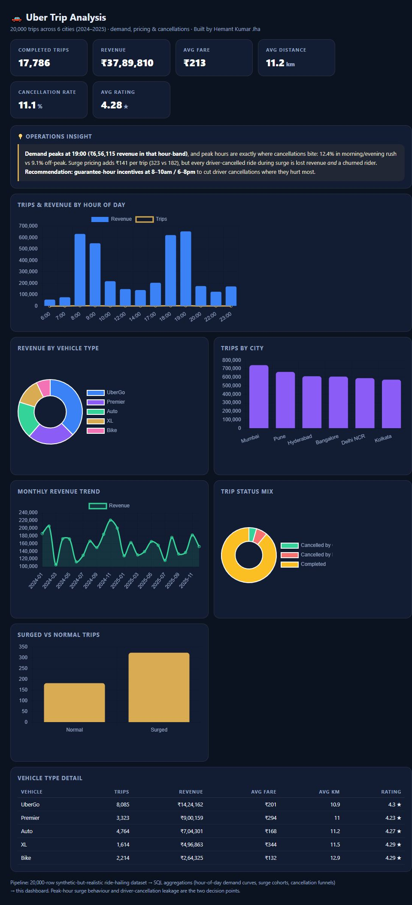

**Live Dashboard:** https://hemantkjha-data.github.io/uber-trip-analysis/dashboard/

# 🚗 Uber Trip Analysis

**Business question:** *Where does demand peak, does surge pricing work, and how much revenue do cancellations cost?*



## ▸ Project Highlights

▸
Analysed 20,000 trips across 6 Indian cities (17,786 completed, 88.9% completion) to map demand, pricing and service-quality patterns.
▸
Mapped the hour-of-day demand curve — evening peak (19:00) delivers ₹6.56 L in a single hour-band, ~4× the mid-day trough.
▸
Isolated the surge effect: surged trips average ₹323 vs ₹182 normal (+₹141/trip), but cancellation risk jumps to 15.2% vs 9.8% during surge.
▸
Diagnosed cancellation leakage — driver cancels (6.6%) outnumber rider cancels (4.5%) and spike to 12.4% in morning/evening rush, driving a guarantee-hour incentive recommendation.

## 📁 Repo Structure

```
├── data/
│   ├── data.csv          # 20,000 trip records (synthetic, deterministic)
│   └── data.db           # SQLite database
├── sql/
│   └── queries.sql       # 10 annotated analytical queries
└── dashboard/
    ├── index.html        # Interactive dashboard (Chart.js)
    ├── agg_data.json     # Pre-computed aggregates
    └── screenshot.jpg
```

## 🚀 How to Run

1. **Dashboard:** open `dashboard/index.html` in any browser.
2. **SQL:** `sqlite3 data/data.db < sql/queries.sql`

## 🔍 Key SQL (peak vs off-peak cancellations)

```sql
SELECT CASE WHEN hour IN (8,9,18,19) THEN 'Peak' ELSE 'Off-peak' END AS period,
       COUNT(*) trips,
       ROUND(100.0*SUM(CASE WHEN status!='Completed' THEN 1 ELSE 0 END)
             /COUNT(*),1) cancel_rate,
       ROUND(AVG(CASE WHEN status='Completed' THEN fare END),0) avg_fare
FROM trips GROUP BY period;
```

## 💡 Analytical Takeaways

1. **Demand is double-peaked** — 8-10am and 6-8pm carry the network; supply should follow the curve, not the clock.
2. **Surge earns and burns** — +77% fare uplift, but 15.2% cancellation during surge means riders experience surge as price *plus* unreliability.
3. **Driver behaviour is the bigger leak** — 6.6% driver-cancel vs 4.5% rider-cancel; guarantee-hour incentives target the exact hours where the loss concentrates.
4. **Service quality holds** — 4.28★ average with wait-time under 5 min; the risk is concentrated, not systemic.

---

*Dataset is synthetic and generated deterministically for portfolio demonstration. All figures are computed from the data via the SQL in `sql/queries.sql`.*

**Built by Hemant Kumar Jha** · Data Analyst · SQL · Python · Dashboards
